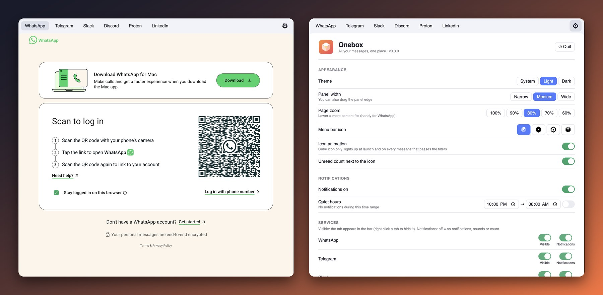
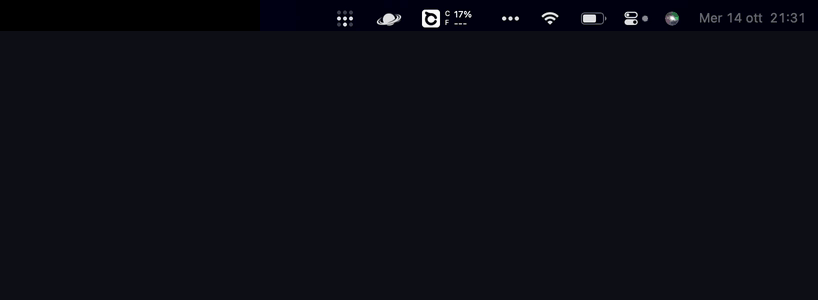
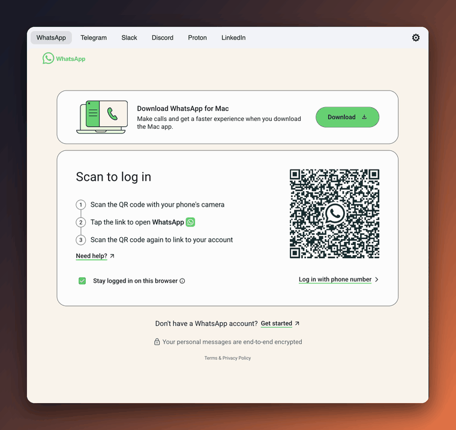
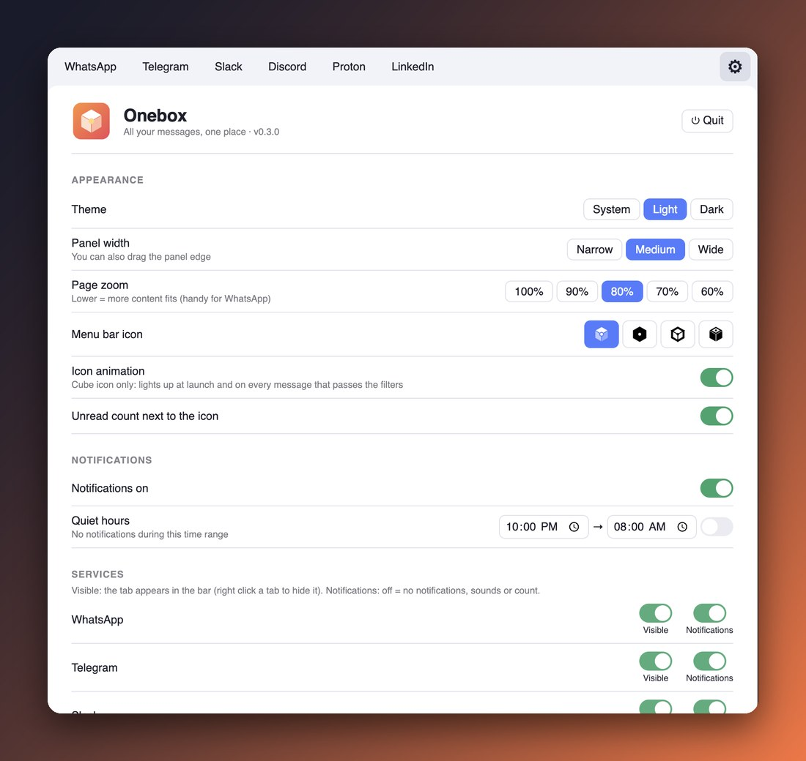
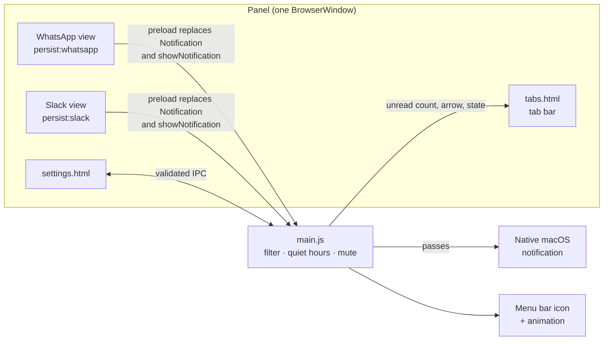

<div align="center">


# Onebox

**All your messages in one place, and only the notifications you care about.**
A macOS menu bar app: WhatsApp, Telegram, Slack, Discord, Proton Mail and LinkedIn in a single panel under the icon. Any other web app is one line in a JSON file.

[](LICENSE)
[](https://www.electronjs.org/)
[](#install)
[](package.json)



</div>

<br>

Chat apps want a window each, a Dock icon each, and a notification for everything.
Onebox is one icon in the menu bar. Click it, a panel drops under it, and every
service is a tab. No Dock icon, no extra windows.

The part that makes it useful: web notifications are intercepted before macOS
sees them, run through **your own filters**, and only then shown as native
notifications. The group chat that never stops can stay silent while your mother
still gets through.

<br>

## Where it lives

Onebox sits in the **menu bar, top right**, as a small cube. Click it and the
panel drops right under the icon, with the arrow pointing at the cube. Click
outside (or the icon again) and it goes away. There is no Dock icon and no window
to find.

<p align="center"></p>

If the icon is not there, an icon manager has probably hidden it, see [Install](#install).

<br>

## The panel

<p align="center"></p>

Each service is the real web app in its own view, with **separate cookies**
(`persist:<id>`), so logins survive restarts and never mix. The number in a tab
is that service's unread count, read from the page title (`(3) WhatsApp`), and
the same total sits next to the menu bar icon.

Right click a tab to **hide** it, **mute** it (no notifications, sounds or count)
or **reload** it.

WhatsApp is always **single-column**: open a chat and the list disappears, like
any other tab. `Esc` or the **‹ Chat** button brings it back.

<br>

## The icon

<p align="center"></p>

A cube with a dot on its vertex: one box, one point where everything arrives.
At launch it builds itself face by face; when a message passes your filters the
dot blinks. Four icon styles (Cube, Solid, Outline, Open) and the animation can
be switched off. The frames are generated by [`tools/make_tray.py`](tools/make_tray.py).

<br>

## Settings

<p align="center"></p>

The gear opens the settings inside the panel. Everything is stored in
`settings.json` and validated key by key, so nothing unexpected gets in from the
page.

| Group | What you can change |
|---|---|
| **Look** | Theme (light by default, or system / dark), panel width (or drag the edge), page zoom, icon style, animation, unread count |
| **Notifications** | Global switch, **quiet hours** (`22:00 → 08:00`, crossing midnight works) |
| **Services** | Per service: visible, notifications on/off |
| **General** | Language (English / Italiano), launch at login, clear media cache on quit, close on click outside, global shortcut |

<br>

## Filters

Services and filters live in `~/Library/Application Support/onebox/services.json`.
`allow` and `deny` are case-insensitive regexes tested on `"title\nbody"` of each
notification.

```json
[
  { "id": "whatsapp", "name": "WhatsApp", "url": "https://web.whatsapp.com",
    "allow": [], "deny": ["^Promo", "\\bgroup spam\\b"] },
  { "id": "slack", "name": "Slack", "url": "https://app.slack.com/client",
    "allow": ["@stefano", "urgent"], "deny": [] }
]
```

- `deny` drops whatever matches.
- `allow`, when not empty, lets through only what matches.
- A broken regex never matches: one notification too many beats one lost.
- Right click the icon → **Edit services…**, then restart. Add any web app by adding an entry.

The filter is plain Node with a built-in self-check: `node filter.js`.

<br>

## How it works



A preload script swaps the page's `Notification` and `ServiceWorkerRegistration.showNotification`
for a stub that sends title and body to the main process. The main process applies
mute, quiet hours and the regex filters, then shows the native notification.
Clicking it opens the panel on that service.

A few details that took measuring rather than guessing:

- **The arrow points at the cube**, not at the middle of the tray item. The item is 42 pt wide without the count and 60 pt with it, so the arrow lands at `x+21` or `x+23`.
- **Web apps are wide**, so every page is zoomed to 80% by default, reapplied on each navigation (Chromium resets it).
- **Google blocks sign-in in embedded browsers**, even with the "Google Chrome" brand in the client hints. Proton Mail works, Gmail web does not.

<br>

## Install

Needs macOS, Node.js and Python 3 only if you want to regenerate the icons.

```bash
git clone https://github.com/stek765/OneBox.git
cd OneBox
./build.sh
open ~/Applications/Onebox.app
```

`build.sh` packages a real `Onebox.app`: macOS does not show notifications from a
bare Electron process. It sets the bundle id, hides the Dock icon, builds the
`.icns` from [`assets/logo.png`](assets/logo.png) and signs ad-hoc.

If the icon disappears, an icon manager (Ice, Bartender) has put it among the
hidden ones: drag it out with `Cmd`. The panel then opens at the top right, and a
global shortcut can be set in the settings.

> The interface is in English by default. Italian is one switch away in Settings › General (saved between sessions). Strings live in [`i18n.js`](i18n.js).

<br>

## Limits

- It only works while the app is running. Pushes to a tab that was never loaded are not intercepted.
- **Gmail** is in the list but hidden: enable it in Settings › Services. It does not work (Google blocks the sign-in, see above). The way around it is IMAP with an app password, or OAuth in the system browser. Not built yet.
- LinkedIn is view-only: no automation of any kind.
- The app is signed **ad-hoc**: there is no verified identity behind it. Build it yourself and read the ~300 lines of `main.js`.
- Onebox saves no files by itself and clears the media cache on quit. Chats and logins stay.

<br>

## Project layout

```
main.js          panel, tray, tabs, settings, notification pipeline
preload.js       notification interception, WhatsApp single-column CSS
filter.js        allow / deny regexes and quiet hours (+ self-check)
tabs.html        tab bar with the arrow
settings.html    settings page
i18n.js          English and Italian UI strings
build.sh         builds ~/Applications/Onebox.app
tools/           logo and menu bar icon generators (Python + numpy)
assets/          logo and icon frames
```

<br>

## Credits

Inspired by [Notihub](https://github.com/Thuong180702/notihub) (MIT), rewritten
from scratch with no runtime dependency besides Electron.

[MIT](LICENSE) © Stefano Zanolli
