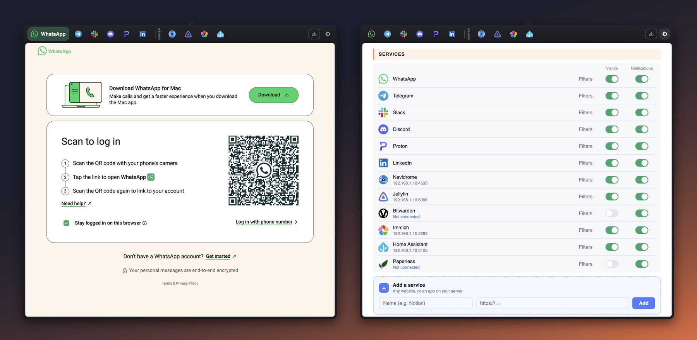
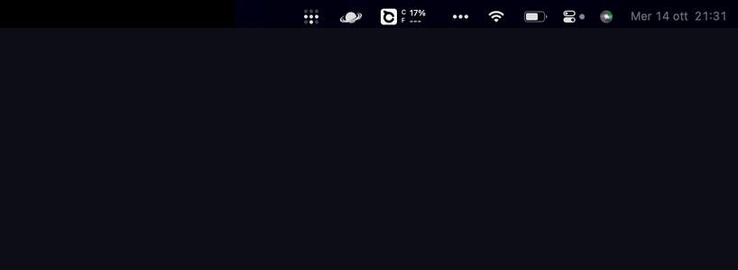
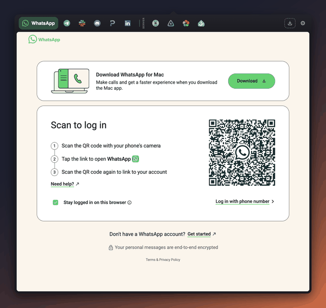
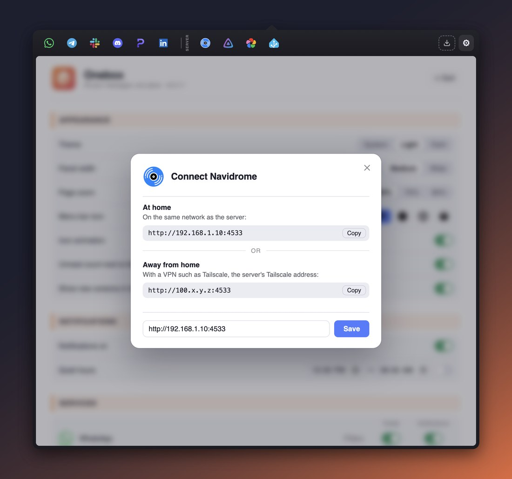
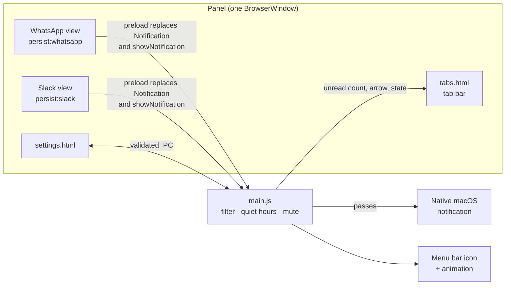

<div align="center">


# Onebox

**All your messages in one place, and only the notifications you care about.**
A macOS menu bar app: WhatsApp, Telegram, Slack, Discord, Proton Mail and LinkedIn in a single panel under the icon, next to the apps on your own server. Any other web app is one click away in Settings.

[](LICENSE)
[](https://www.electronjs.org/)
[](#install)
[](package.json)



</div>

<br>

Chat apps want a window each, a Dock icon each, and a notification for everything.
Onebox is one icon in the menu bar. Click it, a panel drops under it, and every
service is a tab. No Dock icon, no extra windows.

The part that makes it useful: web notifications are intercepted before macOS
sees them, run through **your own filters**, and only then shown as native
notifications. The group chat that never stops can stay silent while your mother
still gets through.

<br>

## Where it lives

Onebox sits in the **menu bar, top right**, as a small cube. Click it and the
panel drops right under the icon, with the arrow pointing at the cube. Click
outside (or the icon again) and it goes away. There is no Dock icon and no window
to find.

<p align="center"></p>

If the icon is not there, an icon manager has probably hidden it, see [Install](#install).

<br>

## The panel

<p align="center"></p>

Each service is the real web app in its own view, with **separate cookies**
(`persist:<id>`), so logins survive restarts and never mix. The number in a tab
is that service's unread count, read from the page title (`(3) WhatsApp`), and
the same total sits next to the menu bar icon.

Right click a tab to **hide** it, **mute** it (no notifications, sounds or count)
or **reload** it.

WhatsApp is always **single-column**: open a chat and the list disappears, like
any other tab. `Esc` or the **‹ Chat** button brings it back.

**Your server.** Navidrome, Jellyfin, Bitwarden, Immich, Home Assistant and Paperless
are built in but off: open one in Settings, type your server's address and its tab
appears after a thin divider marked *SERVER*, with the project's own logo. A short
guide explains the address to use at home or away (through a VPN such as Tailscale),
and that Bitwarden only signs in over https. Click the divider to fold those tabs into
a small stack; drag any tab across it to move it in or out. An app you add yourself
lands there too when its address is a private one (home network, Tailscale, `.local`).

**Add any web app** from Settings, or from the **+** that shows up next to the tabs
when you hover them: a name and an address.

**Park files to send.** Drop files on the menu bar icon, or on the dashed slot at
the top right of the panel: they stack there as a small orange capsule with their
thumbnails. Open the chat you want and drag the capsule in. It leaves as real
files, so Mail or Finder take it too. `×` empties the stack.

Tabs may use the microphone, camera and screen sharing (for calls), and downloads go straight to
`~/Downloads` with a notification.

<br>

## The icon

<p align="center"></p>

A cube with a dot on its vertex: one box, one point where everything arrives.
At launch it builds itself face by face; when a message passes your filters the
dot blinks. Four icon styles (Cube, Solid, Outline, Open) and the animation can
be switched off. The frames are generated by [`tools/make_tray.py`](tools/make_tray.py).

<br>

## Settings

<p align="center"></p>

The gear opens the settings inside the panel. Everything is stored in
`settings.json` and validated key by key, so nothing unexpected gets in from the
page.

| Group | What you can change |
|---|---|
| **Look** | Theme (light by default, or system / dark), panel width (or drag the edge), page zoom, icon style, animation, unread count, new-version notice in the menu bar |
| **Notifications** | Global switch, **quiet hours** (`22:00 → 08:00`, crossing midnight works) |
| **Services** | Per service: visible, notifications on/off, notification filters, the address of your own server; add or remove a service |
| **General** | Language (English / Italiano), launch at login, clear media cache on quit, close on click outside, global shortcut |

### Updates

Once a day Onebox asks GitHub for the latest release. If there is a newer one you
get a notification, the icon turns soft orange and shows `↑version` next to it
(instead of the unread count: switch it off in Settings and the count stays), and
Settings shows **Update to vX**.

Nothing happens until you press it. When the new version runs on the same Electron,
Onebox downloads only its own code (a zip of about 50 KB, signed again on your Mac
like a local build); otherwise it downloads the whole `.dmg`. Either way it checks its
sha256 against the digest GitHub reports for that file, and offers **Restart to
install**: it quits, verifies the signature of the new app, swaps it in place and
reopens. If any step fails the old app stays as it was. The checksum comes from
GitHub itself, so it guards against a damaged download, not against a hijacked
account. Installed with Homebrew? `brew upgrade --cask onebox` does the same.

Only one copy runs at a time: opening a second one just shows the first.

<br>

## Filters

Each service has **Filters** in Settings: *only if it contains* and *never if it
contains*, as words separated by commas. They are stored in
`~/Library/Application Support/onebox/services.json`, where `allow` and `deny` are
case-insensitive regexes tested on `"title\nbody"` of each notification, so a plain
word works and a regex works too.

```json
[
  { "id": "whatsapp", "name": "WhatsApp", "url": "https://web.whatsapp.com",
    "allow": [], "deny": ["^Promo", "\\bgroup spam\\b"] },
  { "id": "slack", "name": "Slack", "url": "https://app.slack.com/client",
    "allow": ["@stefano", "urgent"], "deny": [] }
]
```

- `deny` drops whatever matches.
- `allow`, when not empty, lets through only what matches.
- A broken regex never matches: one notification too many beats one lost.
- The file can also be edited by hand: right click the icon → **Edit services…**, then restart.

The filter is plain Node with a built-in self-check: `node filter.js`.

<br>

## How it works



A preload script swaps the page's `Notification` and `ServiceWorkerRegistration.showNotification`
for a stub that sends title and body to the main process. The main process applies
mute, quiet hours and the regex filters, then shows the native notification.
Clicking it opens the panel on that service.

A few details that took measuring rather than guessing:

- **The arrow points at the cube**, not at the middle of the tray item. The item is 42 pt wide without the count and 60 pt with it, so the arrow lands at `x+21` or `x+23`.
- **Web apps are wide**, so every page is zoomed to 80% by default, reapplied on each navigation (Chromium resets it).
- **Google blocks sign-in in embedded browsers**, even with the "Google Chrome" brand in the client hints. Proton Mail works, Gmail web does not.

<br>

## Install

### Download (Apple Silicon)

Grab `Onebox-0.3.3-arm64.dmg` from the [latest release](https://github.com/stek765/OneBox/releases/latest),
open it and drag **Onebox** into Applications.

**The app is not notarized by Apple** (it is signed ad-hoc), so macOS will refuse the first launch with
"Apple could not verify…". This is expected. To open it anyway:

- **macOS 15 (Sequoia) and later:** try to open the app once, then go to
  *System Settings › Privacy & Security*, scroll down and click **Open Anyway**.
- **Older macOS:** right click the app › **Open** › **Open**.
- **Or from the terminal:** `xattr -dr com.apple.quarantine /Applications/Onebox.app`

The release is built for Apple Silicon (M1 and later). On an Intel Mac, build it yourself.
If you would rather not trust a binary, build it from the source: it is about 650 lines of `main.js`.

### Homebrew

```bash
brew install --cask stek765/tap/onebox
```

The cask lives in [stek765/homebrew-tap](https://github.com/stek765/homebrew-tap) and installs the same
`.dmg`. The first-launch warning above may appear here too.

### Build from source

Needs macOS and Node.js. Python 3 only if you want to regenerate the icons.

```bash
git clone https://github.com/stek765/OneBox.git
cd OneBox
./build.sh
open /Applications/Onebox.app
```

`build.sh` installs into `/Applications` (`OUT=/some/path/Onebox.app ./build.sh` to put it elsewhere) and packages a real `Onebox.app`: macOS does not show notifications from a
bare Electron process. It sets the bundle id, hides the Dock icon, builds the
`.icns` from [`assets/logo.png`](assets/logo.png) and signs ad-hoc, or with a
local code-signing certificate named `Onebox Dev` if your keychain has one: then
the identity stays the same across builds and macOS stops asking again for folder
access after each rebuild.

If the icon disappears, an icon manager (Ice, Bartender) has put it among the
hidden ones: drag it out with `Cmd`. The panel then opens at the top right, and a
global shortcut can be set in the settings.

> The interface is in English by default. Italian is one switch away in Settings › General (saved between sessions). Strings live in [`i18n.js`](i18n.js).

<br>

## Limits

- It only works while the app is running. Pushes to a tab that was never loaded are not intercepted.
- **Gmail** is not included: Google blocks the sign-in in embedded browsers (see above).
- LinkedIn is view-only: no automation of any kind.
- The app is signed **ad-hoc**: there is no verified identity behind it. Build it yourself and read the ~650 lines of `main.js`.
- Onebox saves no files by itself and clears the media cache on quit. Chats and logins stay.

<br>

## Project layout

```
main.js          panel, tray, tabs, settings, notification pipeline
preload.js       notification interception, WhatsApp single-column CSS
filter.js        allow / deny regexes and quiet hours (+ self-check)
tabs.html        tab bar with the arrow
settings.html    settings page
i18n.js          English and Italian UI strings
build.sh         builds /Applications/Onebox.app
tools/           logo and menu bar icon generators (Python + numpy)
assets/          logo, icon frames, logos of the built-in services
```

<br>

## Credits

Inspired by [Notihub](https://github.com/Thuong180702/notihub) (MIT), rewritten
from scratch with no runtime dependency besides Electron. Service logos from
[dashboard-icons](https://github.com/homarr-labs/dashboard-icons) (Apache-2.0) and
[Simple Icons](https://simpleicons.org) (CC0).

[MIT](LICENSE) © Stefano Zanolli
